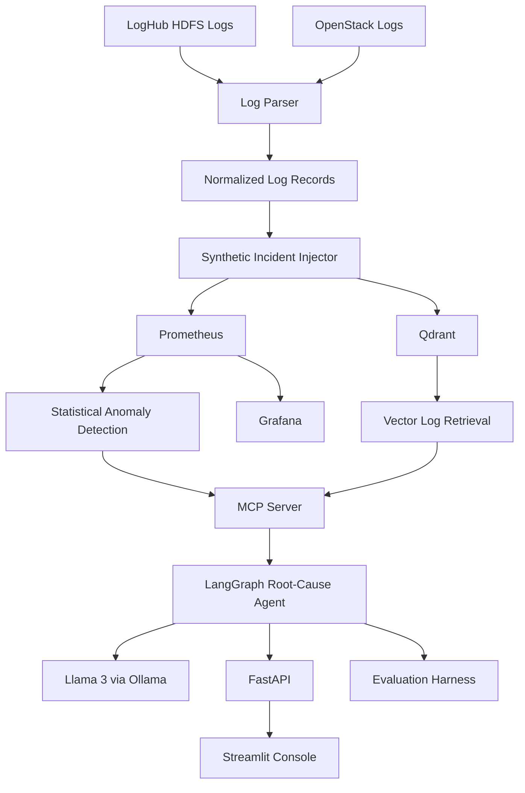

# OpsCopilot — AI SRE Copilot

## 1. Project Overview

OpsCopilot is an AI SRE Copilot for observability and incident root-cause analysis.

The system combines logs, metrics, anomaly detection, vector-based log retrieval, MCP observability tools, LangGraph orchestration, and an LLM reasoning layer to investigate production-style incidents.

The main objective is to reduce the manual effort required to correlate logs, metrics, and deployment information during an incident and produce an evidence-grounded root-cause hypothesis.

## 2. Problem Statement

Production incidents often require engineers to manually inspect:

- Application and infrastructure logs
- CPU and memory metrics
- Request latency
- Error rates
- Recent deployments
- Service dependencies

This manual investigation can be time-consuming because relevant evidence is distributed across different observability sources.

OpsCopilot addresses this problem by providing an investigation workflow that collects relevant evidence and uses an LLM to generate an evidence-grounded root-cause hypothesis.

## 3. Key Features

OpsCopilot provides:

- Log ingestion and normalization
- Synthetic incident generation
- Statistical anomaly detection
- Prometheus metric monitoring
- Qdrant vector-based log retrieval
- MCP observability tools
- LangGraph investigation orchestration
- Llama 3 reasoning through Ollama
- FastAPI backend
- Streamlit observability console
- Synthetic incident benchmark
- Exact-match evaluation
- Evidence-grounding evaluation
- LLM-as-judge evaluation
- Docker-based local deployment

## 4. System Architecture



## 5. End-to-End Workflow

```text
Raw Logs
   ↓
Log Parsing and Normalization
   ↓
Synthetic Incident Generation
   ↓
Metric and Log Evidence
   ↓
Prometheus + Qdrant
   ↓
MCP Observability Tools
   ↓
LangGraph Investigation Agent
   ↓
Llama 3 Reasoning
   ↓
Evidence-Grounded Root-Cause Hypothesis
   ↓
FastAPI
   ↓
Streamlit Observability Console
```

The evaluation pipeline independently tests the agent against predefined synthetic incident scenarios.

## 6. Technology Stack

| Component | Technology | Purpose |
|---|---|---|
| Log Sources | LogHub HDFS + OpenStack | Real log datasets |
| Log Processing | Python | Parsing and normalization |
| Metrics | Prometheus | Time-series monitoring |
| Dashboards | Grafana | Metric visualization |
| Vector Database | Qdrant | Semantic log retrieval |
| Embeddings | all-MiniLM-L6-v2 | Log embeddings |
| Agent Framework | LangGraph | Investigation orchestration |
| LLM | Llama 3 | Evidence-based reasoning |
| LLM Runtime | Ollama | Local model serving |
| Tool Protocol | MCP | Observability tool access |
| Backend | FastAPI | Investigation API |
| Frontend | Streamlit | Observability console |
| Containerization | Docker Compose | Local deployment |
| Evaluation | Python | Benchmark and scoring |

## 7. Data Sources

### HDFS

The HDFS dataset is obtained from LogHub and contains Hadoop Distributed File System logs.

The HDFS data demonstrates large-scale log ingestion and normalization.

The parser extracts information such as:

- Timestamp
- Service
- Log level
- Block ID
- Message
- Status
- Response time when available

### OpenStack

The OpenStack dataset is also obtained from LogHub.

It contains normal and abnormal infrastructure and service logs.

OpenStack is used as the primary source for the synthetic incident benchmark.

## 8. Normalized Log Schema

Different log sources are converted into a common structure.

```json
{
  "timestamp": "...",
  "source": "...",
  "service": "...",
  "level": "...",
  "entity_id": "...",
  "message": "..."
}
```

Additional metadata can include:

```text
pid
log_file
line_number
status
response_time
incident_id
synthetic
```

This common representation allows downstream components to process different log sources consistently.

## 9. Synthetic Incident Benchmark

OpsCopilot currently contains eight benchmark scenarios:

| Incident | Scenario | Primary Signal |
|---|---|---|
| INC001 | VM operation failure | CPU |
| INC002 | Memory leak / OOM | Memory |
| INC003 | Deployment error | Error rate |
| INC004 | Latency degradation | Request latency |
| INC005 | Cascading service failure | Error rate |
| INC006 | CPU saturation | CPU |
| INC007 | Disk/storage pressure | Disk |
| INC008 | Network connectivity failure | Network error rate |

Each incident contains a known ground-truth scenario and expected evidence.

## 10. Anomaly Detection

OpsCopilot uses statistical threshold-based anomaly detection.

A baseline is calculated from the observed metric stream.

```text
Baseline Mean
     +
Statistical Threshold
     ↓
Upper Control Limit
```

and:

```text
Baseline Mean
     -
Statistical Threshold
     ↓
Lower Control Limit
```

Metric observations outside the expected range are treated as anomalies.

The anomaly detector provides an initial indication that an incident may be occurring.

The project does not train a conventional supervised machine-learning model for root-cause classification.

Instead, the system combines:

```text
Statistical Anomaly Detection
          +
Observability Retrieval
          +
LLM Reasoning
```

## 11. Vector Log Retrieval

Qdrant is used for semantic log retrieval.

Log messages are embedded using:

```text
all-MiniLM-L6-v2
```

The resulting embeddings are stored in Qdrant along with metadata.

Retrieval is constrained by the incident time window so that the agent receives evidence relevant to the investigated incident.

## 12. MCP Observability Tools

The agent accesses observability information through MCP tools.

### `query_metrics()`

Queries Prometheus for metric observations within a specified time range.

### `search_logs()`

Searches Qdrant for relevant log messages within the incident window.

### `get_recent_deploys()`

Retrieves deployment information around the incident time window.

The MCP layer allows the agent to access structured observability information instead of relying only on the LLM's general knowledge.

## 13. Investigation Agent

LangGraph orchestrates the investigation.

```text
Collect Metrics
      ↓
Collect Logs
      ↓
Collect Deployments
      ↓
Prepare Evidence
      ↓
Reason About Incident
      ↓
Generate Final Report
```

The investigation state contains:

- Incident ID
- Source
- Start time
- End time
- Affected entity
- Metric name
- Log query
- Metric results
- Log results
- Deployment results
- Evidence context
- Root-cause hypothesis
- Final report

## 14. LLM Reasoning

The reasoning component uses Llama 3 through Ollama.

```text
Collected Evidence
       ↓
     Llama 3
       ↓
Root-Cause Hypothesis
```

The agent is instructed to:

- Use only supplied evidence
- Avoid inventing services or entities
- Separate observations from hypotheses
- Reference supporting evidence
- Avoid treating correlation as confirmed causation
- Report insufficient evidence when appropriate
- Avoid unsupported root-cause claims

The final output is therefore an evidence-grounded hypothesis rather than an automatically confirmed diagnosis.

## 15. FastAPI Backend

FastAPI provides the backend API.

Main endpoints:

```text
GET  /
GET  /health
POST /v1/investigate
```

The investigation endpoint receives information such as:

```text
Incident ID
Source
Start time
End time
Affected entity
Metric
Log query
```

The API executes the investigation workflow and returns the collected evidence and generated report.

## 16. Streamlit Console

Streamlit provides the user-facing observability console.

The console displays:

- Incident information
- Investigation status
- Metric evidence
- Retrieved logs
- Deployment information
- Investigation pipeline
- Root-cause hypothesis
- Evidence citations
- Agent trace
- Final report
- Raw investigation details

The Streamlit application communicates with FastAPI.

## 17. Evaluation

The evaluation pipeline is:

```text
Ground Truth
     ↓
Agent Investigation
     ↓
Generated Hypothesis
     ↓
Exact-Match Evaluation
     ↓
Evidence Grounding
     ↓
LLM-as-Judge
```

The evaluation measures:

- Exact-match accuracy
- Grounded accuracy
- Evidence coverage
- LLM judge score
- LLM judge pass rate

## 18. Initial Evaluation Results

The completed initial benchmark contained eight incidents.

```text
Benchmark scenarios:       8
Exact-match accuracy:      75.00%
Grounded accuracy:         100.00%
Mean evidence coverage:    91.67%
Successful LLM judgments:  7 / 8
LLM judge pass rate:       28.57%
Mean LLM judge score:      2.14 / 5
```

The exact-match failures were primarily terminology differences such as:

```text
OOM
vs.
out-of-memory condition
```

and:

```text
network connectivity failure
vs.
network connectivity degraded
```

The investigations remained grounded in the retrieved evidence.

## 19. Evaluation Limitations

Known limitations include:

1. The benchmark incidents are synthetic.
2. The benchmark currently contains eight scenarios.
3. Exact-match evaluation is sensitive to terminology.
4. LLM-as-judge results depend on the local evaluation model.
5. The complete revised eight-incident benchmark was not rerun after the scorer revision.
6. Local LLM evaluation can require substantial system resources.
7. The benchmark does not represent real production incident distributions.
8. Root-cause outputs are hypotheses rather than confirmed causal diagnoses.

## 20. Where the Agent Gets It Wrong

The evaluation identified several failure modes.

### Terminology Mismatch

The agent can identify the correct incident but use a semantically equivalent phrase that does not exactly match the benchmark label.

### Causal Overstatement

The agent may sometimes describe temporal correlation using stronger causal wording than the evidence supports.

### Deployment Metadata Coverage

Deployment information may not be returned by the deployment-history tool even when deployment-related evidence is present in retrieved logs.

### Resource Constraints

Running multiple LLM-based evaluations locally can create significant CPU and memory load.

### Small Benchmark

The current eight-scenario benchmark should be expanded before making broader claims about generalization.

## 21. Deployment

OpsCopilot is designed for reproducible local deployment using Docker Compose.

The infrastructure includes:

```text
Docker Compose
│
├── Elasticsearch
├── Prometheus
├── Grafana
├── Qdrant
├── MCP Server
├── FastAPI Agent API
└── Streamlit Console
```

During development, the required infrastructure and application components were validated locally.

The complete multi-service stack requires substantial memory, so the full stack was not continuously run simultaneously on the development laptop.

Therefore, the current deployment should be described as a reproducible local deployment rather than a public cloud deployment.

## 22. Project Structure

```text
opscopilot/
│
├── agent/
│   └── LangGraph investigation workflow
│
├── api/
│   └── FastAPI backend
│
├── console/
│   └── Streamlit interface
│
├── evaluation/
│   └── Benchmark and scoring
│
├── ingestion/
│   └── Log parsing and incident injection
│
├── mcp_server/
│   └── Observability tools
│
├── retrieval/
│   └── Embedding and Qdrant retrieval
│
├── configs/
│   └── Infrastructure configuration
│
├── data/
│   ├── raw/
│   └── processed/
│
├── docs/
│   ├── architecture.md
│   └── eval_report.md
│
├── tests/
│   └── Automated tests
│
├── docker-compose.yml
├── README.md
└── .gitignore
```

## 23. Local Setup

### Prerequisites

Install or configure:

- Python
- Docker Desktop
- Ollama
- Llama 3
- Git

The project also requires the Python dependencies listed in the project's dependency configuration.

### Clone the Repository

```bash
git clone <repository-url>
cd opscopilot
```

### Create a Virtual Environment

Windows:

```powershell
python -m venv .venv
.venv\Scripts\activate
```

### Install Dependencies

```powershell
pip install -r requirements.txt
```

### Start Required Infrastructure

```powershell
docker compose up -d
```

For development on a resource-constrained machine, only the required infrastructure services can be started.

For example:

```powershell
docker start opscopilot-qdrant opscopilot-prometheus
```

### Start Ollama

Ensure Ollama is running and the required model is available.

```powershell
ollama run llama3
```

## 24. Running the Backend

Start FastAPI:

```powershell
python -m uvicorn api.main:app --reload --port 8000
```

The API is then available locally at:

```text
http://127.0.0.1:8000
```

Health endpoint:

```text
http://127.0.0.1:8000/health
```

## 25. Running the Streamlit Console

Start the OpsCopilot console:

```powershell
python -m streamlit run console/streamlit_app.py --server.port 8502
```

The console is available locally at:

```text
http://localhost:8502
```

The project uses port `8502` for the OpsCopilot console.

## 26. Running an Investigation

The Streamlit console allows an incident to be selected and investigated.

The investigation flow is:

```text
Select Incident
      ↓
Send Request to FastAPI
      ↓
Collect Metrics
      ↓
Search Logs
      ↓
Check Deployments
      ↓
Prepare Evidence
      ↓
LLM Reasoning
      ↓
Display Root-Cause Hypothesis
```

The console displays the evidence and final report returned by the backend.

## 27. Testing

Python syntax checks can be performed using:

```powershell
python -m py_compile agent\graph.py
python -m py_compile evaluation\scorer.py
```

Automated tests can be executed using:

```powershell
pytest
```

The anomaly detector tests currently validate the statistical detection component.

## 28. Evaluation

The benchmark evaluation can be run using the project's evaluation script.

The evaluation produces results for:

```text
Exact Match
Grounded Accuracy
Evidence Coverage
LLM-as-Judge
```

The evaluation results should be interpreted together with the documented failure cases.

## 29. Observability Components

### Prometheus

Prometheus stores and queries the synthetic metric streams.

### Grafana

Grafana provides metric visualization.

### Qdrant

Qdrant stores log embeddings and supports semantic retrieval.

### Elasticsearch

Elasticsearch is included in the deployment architecture for scalable log storage/search capabilities.

### MCP Server

The MCP server exposes structured observability tools to the investigation agent.

## 30. Responsible Interpretation

OpsCopilot is an investigation assistant rather than an autonomous production incident authority.

The system produces evidence-grounded hypotheses.

A generated hypothesis should therefore be interpreted as:

```text
Evidence
   +
Model Reasoning
   ↓
Root-Cause Hypothesis
```

and not as:

```text
Model Output
   ↓
Confirmed Production Root Cause
```

The final decision should remain with the responsible engineer.

## 31. Current Status

The current implementation includes:

```text
[✓] HDFS and OpenStack data ingestion
[✓] Common log normalization
[✓] Synthetic incident generation
[✓] Prometheus metric monitoring
[✓] Statistical anomaly detection
[✓] Qdrant vector retrieval
[✓] MCP observability tools
[✓] LangGraph investigation agent
[✓] Llama 3 + Ollama reasoning
[✓] FastAPI backend
[✓] Streamlit console
[✓] Synthetic benchmark
[✓] Evaluation scorer
[✓] Docker Compose deployment configuration
[✓] Architecture documentation
[✓] Evaluation documentation
```

## 32. Future Improvements

Potential future improvements include:

- Live production telemetry
- Larger incident benchmarks
- More realistic incident injection
- Additional observability metrics
- Improved deployment metadata integration
- Persistent incident history
- Human feedback
- Larger evaluation datasets
- Cloud deployment
- Authentication
- Automated notifications
- Additional observability integrations
- More advanced anomaly detection

## 33. Project Summary

OpsCopilot brings together observability infrastructure, retrieval, agent orchestration, and LLM reasoning into an end-to-end incident investigation workflow.

The system answers three core questions:

```text
What happened?
       ↓
What evidence supports it?
       ↓
What is the root-cause hypothesis?
```

The project demonstrates how an AI agent can use structured observability tools and retrieved evidence to assist with incident investigation while explicitly exposing uncertainty and known failure modes.