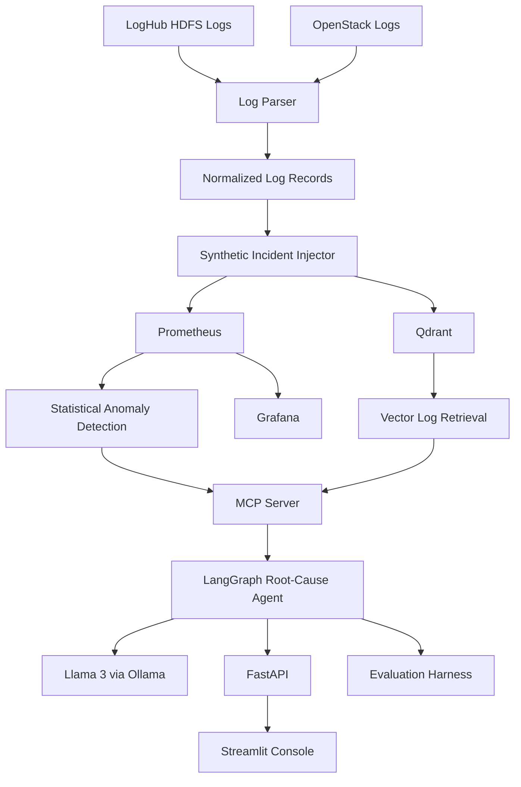

# OpsCopilot Architecture

## 1. Overview

OpsCopilot is an AI SRE Copilot designed for observability and incident root-cause analysis.

The system combines infrastructure logs, metric signals, anomaly detection, vector-based log retrieval, MCP tools, LangGraph orchestration, and an LLM reasoning layer to investigate production-style incidents.

The main goal is to reduce the manual effort required to correlate logs, metrics, and deployment information during an incident and produce an evidence-grounded root-cause hypothesis.

## 2. System Architecture



## 3. End-to-End Workflow

The complete OpsCopilot investigation workflow is:

```text
Raw Logs
   ↓
Log Parsing and Normalization
   ↓
Synthetic Incident Generation
   ↓
Metric and Log Evidence
   ↓
Prometheus + Qdrant
   ↓
MCP Observability Tools
   ↓
LangGraph Investigation Agent
   ↓
Llama 3 Reasoning
   ↓
Evidence-Grounded Root-Cause Hypothesis
   ↓
FastAPI
   ↓
Streamlit Observability Console
```

The evaluation pipeline independently tests the agent using predefined synthetic incident scenarios.

## 4. Data Sources

### HDFS Dataset

The HDFS dataset is obtained from LogHub and contains Hadoop Distributed File System logs.

The HDFS data is used to demonstrate large-scale log ingestion and normalization.

The parser extracts information including:

- Timestamp
- Service
- Log level
- Block ID
- Message
- Status
- Response time when available

The large HDFS log file is processed into JSONL format for downstream processing.

### OpenStack Dataset

OpenStack logs are also obtained from LogHub.

The dataset contains normal and abnormal infrastructure and service logs.

OpenStack is used as the primary source for the synthetic incident benchmark because its logs provide infrastructure and service-level events that can be correlated with synthetic metric signals.

## 5. Log Ingestion and Normalization

The ingestion layer converts different log formats into a common schema.

The normalized log structure is:

```json
{
  "timestamp": "...",
  "source": "...",
  "service": "...",
  "level": "...",
  "entity_id": "...",
  "message": "..."
}
```

Additional metadata can also be preserved when available:

- Process ID
- Log file
- Line number
- Status
- Response time
- Incident ID
- Synthetic flag

This normalization allows the retrieval and reasoning components to work consistently across different log sources.

## 6. Synthetic Incident Injection

Real production incidents are difficult to reproduce consistently for testing.

OpsCopilot therefore contains a synthetic incident injector that creates controlled incident scenarios with known ground truth.

Each synthetic incident contains:

- Incident ID
- Incident type
- Affected entity
- Incident start time
- Incident end time
- Ground-truth description
- Associated metric signal
- Synthetic log events

The generated metric and log events are aligned to the same incident time window.

This makes it possible to evaluate whether the agent can correctly identify the type of incident from the available evidence.

## 7. Incident Benchmark

The current benchmark contains eight incident scenarios:

| Incident | Scenario |
|---|---|
| INC001 | VM operation failure |
| INC002 | Memory leak / OOM |
| INC003 | Deployment error |
| INC004 | Latency degradation |
| INC005 | Cascading service failure |
| INC006 | CPU saturation |
| INC007 | Disk/storage pressure |
| INC008 | Network connectivity failure |

Each scenario contains predefined ground-truth information and expected evidence.

## 8. Metric Monitoring

Prometheus is used as the metric collection and monitoring component.

The synthetic metric feeder provides observability signals including:

- CPU usage
- Memory usage
- Request latency
- Error rate
- Disk usage
- Network error rate

The metric feeder generates normal, incident, and recovery periods.

Prometheus periodically scrapes the metric endpoint and stores the resulting time-series data.

## 9. Anomaly Detection

OpsCopilot uses statistical threshold-based anomaly detection to identify unusual metric behaviour.

A baseline is calculated from the observed metric stream.

Conceptually:

```text
Baseline Mean
     +
Statistical Threshold
     ↓
Upper Control Limit
```

and:

```text
Baseline Mean
     -
Statistical Threshold
     ↓
Lower Control Limit
```

Metric observations outside the expected range are treated as anomalies.

The anomaly detector provides an initial signal that an incident may be occurring.

OpsCopilot does not train a conventional supervised machine-learning model for root-cause classification. Instead, the system combines statistical anomaly detection with retrieval and LLM-based reasoning.

## 10. Vector Log Retrieval

Qdrant is used as the vector database for semantic log retrieval.

Log messages are converted into vector embeddings using:

```text
all-MiniLM-L6-v2
```

The embeddings allow semantically relevant log records to be retrieved even when the search wording does not exactly match the original log message.

Each indexed record stores metadata such as:

- Timestamp
- Source
- Service
- Log level
- Entity ID
- Message
- Incident ID
- Synthetic flag
- Log file
- Line number
- Process ID
- Status
- Response time

The retrieval process also applies the incident time window so that evidence is restricted to the relevant period.

## 11. MCP Observability Tools

OpsCopilot uses MCP tools to provide the agent with access to observability information.

The main tools are:

### `query_metrics()`

Queries Prometheus for metric samples within a specified time range.

### `search_logs()`

Searches the Qdrant vector store for relevant log messages within the incident window.

### `get_recent_deploys()`

Retrieves deployment information around the incident time window.

These tools allow the agent to gather evidence from the observability infrastructure rather than relying only on the language model's general knowledge.

## 12. LangGraph Investigation Agent

LangGraph is used to orchestrate the investigation workflow.

The agent follows a structured sequence:

```text
Collect Metrics
      ↓
Collect Logs
      ↓
Collect Deployments
      ↓
Prepare Evidence
      ↓
Reason About Incident
      ↓
Generate Final Report
```

The investigation state contains information such as:

- Incident ID
- Source
- Start time
- End time
- Affected entity
- Metric name
- Log query
- Metric results
- Log results
- Deployment results
- Evidence context
- Root-cause hypothesis
- Final report

This structured workflow makes the investigation process reproducible and easier to inspect.

## 13. LLM Reasoning

The reasoning component uses Llama 3 through Ollama.

The reasoning flow is:

```text
Collected Evidence
       ↓
Llama 3
       ↓
Root-Cause Hypothesis
```

The model is instructed to reason only from the evidence collected by the tools.

The reasoning process is designed to:

- Use supplied evidence
- Avoid inventing services or entities
- Separate observations from hypotheses
- Reference supporting evidence
- Avoid treating correlation as confirmed causation
- Report insufficient evidence when appropriate
- Avoid unsupported root-cause claims

The LLM therefore acts as a grounded reasoning component within the investigation pipeline.

## 14. Evidence Grounding

OpsCopilot separates observed evidence from model interpretation.

### Observed Evidence

Observed evidence comes directly from the system's retrieved data:

- Prometheus metric samples
- Retrieved log records
- Deployment information

### Root-Cause Hypothesis

The root-cause hypothesis is the model's interpretation of the collected evidence.

For example:

```text
Observed Evidence:
CPU usage increased significantly during the incident window.

Observed Evidence:
CPU-related error logs were retrieved.

Hypothesis:
The incident is consistent with CPU saturation.
```

The system explicitly distinguishes a hypothesis from confirmed causation.

## 15. FastAPI Backend

FastAPI provides the backend API for the OpsCopilot application.

The main endpoints are:

```text
GET  /
GET  /health
POST /v1/investigate
```

The investigation endpoint receives incident information such as:

- Incident ID
- Source
- Start time
- End time
- Affected entity
- Metric
- Log query

The API then executes the investigation workflow and returns the collected evidence and generated report.

The FastAPI backend acts as the communication layer between the Streamlit interface and the investigation agent.

## 16. Streamlit Console

Streamlit provides the user-facing OpsCopilot observability console.

The interface displays:

- Incident information
- Investigation status
- Metric evidence
- Retrieved logs
- Deployment information
- Investigation pipeline
- Root-cause hypothesis
- Evidence citations
- Agent trace
- Final report
- Raw investigation details

The Streamlit application communicates with FastAPI instead of directly executing the investigation workflow.

## 17. Evaluation Architecture

The evaluation framework tests the agent against predefined synthetic incidents.

The evaluation flow is:

```text
Ground Truth
     ↓
Agent Investigation
     ↓
Generated Hypothesis
     ↓
Exact-Match Evaluation
     ↓
Evidence Grounding
     ↓
LLM-as-Judge
```

The evaluation measures:

- Exact-match accuracy
- Grounded accuracy
- Evidence coverage
- LLM judge score
- LLM judge pass rate

The evaluation also records failure cases so that incorrect or incomplete agent behaviour is visible.

## 18. Deployment Architecture

OpsCopilot is designed as a Docker-based local deployment.

The documented infrastructure contains:

```text
Docker Compose
│
├── Elasticsearch
├── Prometheus
├── Grafana
├── Qdrant
├── MCP Server
├── FastAPI Agent API
└── Streamlit Console
```

During development, the required infrastructure services and application components were validated locally.

The complete multi-service stack can require significant memory, so the full stack was not continuously run simultaneously on the development laptop.

The current deployment should therefore be described as a reproducible local deployment rather than a public cloud deployment.

## 19. Repository Structure

The main repository responsibilities are:

```text
opscopilot/
│
├── agent/
│   └── LangGraph investigation workflow
│
├── api/
│   └── FastAPI backend
│
├── console/
│   └── Streamlit interface
│
├── evaluation/
│   └── Benchmark and scoring
│
├── ingestion/
│   └── Log parsing and incident injection
│
├── mcp_server/
│   └── Observability tools
│
├── retrieval/
│   └── Embedding and Qdrant retrieval
│
├── configs/
│   └── Infrastructure configuration
│
├── data/
│   ├── raw/
│   └── processed/
│
├── docs/
│   ├── architecture.md
│   └── eval_report.md
│
├── tests/
│   └── Automated tests
│
├── docker-compose.yml
├── README.md
└── .gitignore
```

## 20. Reliability and Safety Design

OpsCopilot includes several mechanisms to make the investigation process more reliable.

### Evidence-Based Reasoning

The agent is instructed to reason using the evidence returned by the observability tools.

### Time-Window Filtering

Metrics and logs are retrieved using the incident time window to reduce unrelated evidence.

### Evidence Citations

Retrieved evidence is preserved so that conclusions can be traced back to supporting records.

### Observation and Hypothesis Separation

The application distinguishes observed system behaviour from the model's interpretation.

### Uncertainty Handling

If the retrieved evidence is insufficient, the agent can report that the root cause is undetermined.

### Evaluation Failure Reporting

The evaluation framework records incorrect or incomplete cases so that weaknesses in the agent are visible.

## 21. Current Limitations

The current implementation has the following limitations:

1. The benchmark incidents are synthetic.
2. The metric feed is synthetic rather than connected to a live production monitoring environment.
3. Deployment information is currently represented through the project's deployment-history source.
4. The LLM reasoning layer depends on the locally available Llama 3 model through Ollama.
5. Running the complete infrastructure stack simultaneously requires substantial local memory.
6. The project has not been deployed as a public cloud application.
7. Root-cause outputs are evidence-based hypotheses and should not be treated as confirmed causal diagnoses.
8. The current evaluation benchmark is intentionally small and can be expanded in future work.

## 22. Future Extensions

Potential future improvements include:

- Integration with live production telemetry
- Larger and more diverse incident benchmarks
- More realistic incident injection
- Additional observability metrics
- Real deployment metadata integration
- Persistent incident history
- Human feedback on agent conclusions
- Expanded evaluation datasets
- Cloud deployment
- Authentication and access control
- Automated incident notifications
- Integration with additional observability platforms

## 23. Summary

OpsCopilot combines:

- Log ingestion
- Statistical anomaly detection
- Vector-based retrieval
- Prometheus
- Qdrant
- MCP tools
- LangGraph
- Llama 3
- FastAPI
- Streamlit
- Docker

into an end-to-end incident investigation system.

The overall workflow is designed to answer three questions:

```text
What happened?
       ↓
What evidence supports it?
       ↓
What is the root-cause hypothesis?
```

The architecture prioritizes evidence grounding, traceability, and transparent separation between observed facts and model-generated hypotheses.